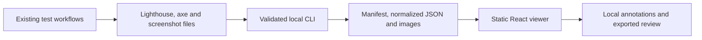

# ReleaseProof — a portable frontend regression review packet

Status: M1 implemented · Priority: fourth · Effort: 95–140 focused hours.

Read [shared engineering standards](ENGINEERING.md) and [research](RESEARCH.md). This tool is useful to maintainers of the other three projects, but must also work independently with a stranger's repository.

## 1. Problem and user

### M1 Implementation Status
The M1 workflow has been implemented with end-to-end testing. The main sample journey is now fully functional with meaningful behavior tests that validate artifact generation, packet creation, and review workflow. The implementation maintains original data requirements and includes failure recovery scenarios.

Key implemented features:
- Baseline and candidate artifact selection
- Review packet generation
- Scenario navigation
- Evidence display
- Review decision tracking
- Accessibility validation
- Failure recovery mechanisms

A frontend maintainer reviews a pull request containing visual, performance and accessibility changes. Evidence is scattered across CI logs, screenshots, Lighthouse reports and axe output. A worse score may be noise, an accessibility finding may already exist, and a screenshot may come from a different viewport. The reviewer needs a coherent comparison with provenance before deciding what to investigate.

ReleaseProof turns outputs from existing tools into a static review packet. Its viewer highlights newly observed issues, comparable performance changes and visual differences, with links to the underlying evidence and an explicit “not comparable” state. It never makes an unsupported automatic “safe to release” claim.

[Lighthouse CI](https://github.com/GoogleChrome/lighthouse-ci/blob/main/docs/configuration.md) already provides assertions and build comparisons. Playwright already produces test artifacts. ReleaseProof's proposed value is a portable cross-tool review workspace with local import and no hosted dashboard subscription. Do not reimplement Lighthouse, axe or a browser-testing framework.

### Discovery gate

Ask three maintainers to review a real or synthetic PR using their existing artifacts. Observe which comparisons take time and which data they distrust. Test a static prototype with deliberately incompatible runs. Proceed if combining evidence helps two maintainers make a clearer decision. If Lighthouse CI plus a README is sufficient, narrow the product to portable visual/a11y triage or contribute that integration upstream.

Success targets: a reviewer identifies the three seeded regressions and the intentionally incomparable run without false certainty; reviewing a packet requires no account, token or installation. Measure review time against the same reviewers' current workflow before claiming improvement.

## 2. V1 scope

- A Node CLI `releaseproof build --baseline <dir> --candidate <dir> --out <dir>` validates and normalizes local artifacts into a packet. It does not execute user-supplied shell commands or crawl arbitrary URLs.
- Supported inputs: a documented Lighthouse JSON subset, axe results from a provided Playwright helper, and screenshots listed in an explicit manifest. Freeze tested input-version ranges in the compatibility table.
- A static React viewer loads a generated packet, or imports a packet directory through a file picker. Also accept loose manifest/report/image selection as a fallback. No ZIP import in v1, avoiding decompression-bomb and archive-path complexity.
- Route/viewport/scenario filters; overview of new/resolved/persistent findings; metric comparison with raw runs; screenshot side-by-side/diff/overlay with keyboard-accessible controls.
- Review annotations stored locally and exported as JSON/Markdown: observed problem, owner, decision, rationale and expiry for an accepted exception. “Reviewed” means a human decision, not passing all quality checks.
- Build metadata: baseline/candidate commits, tool/browser versions, viewport, OS/image identifier, timestamps and measurement settings.
- Synthetic example packet plus an integration recipe for any static web app; dogfood on ImportDesk and FormPath after independent setup works.

Out of scope: SaaS accounts, hosted crawling, production telemetry collection, automatic PR comments with broad permissions, arbitrary HTML report rendering, AI root-cause claims, a replacement CI provider or claiming full WCAG conformance.

## 3. UX and visual direction

Human: a maintainer deciding whether a frontend change needs more investigation. Task: inspect evidence and record a defensible review. Feel: an evidence desk with precise comparisons, not a traffic-light scorecard.

Domain: baseline, candidate, scenario, finding, sample, delta, exception, provenance. Color world: white evidence sheets, charcoal labels, muted violet comparison marks, red changed regions, slate unknown states. Signature: every result has a small provenance strip showing both revisions and whether the environments match. Repeat this on overview rows, metric charts, screenshot comparisons, finding details and exported review summaries.

Avoid a giant aggregate score, charts without raw values and red/green-only judgment. Put “not comparable” ahead of a misleading delta. Warnings about insufficient data should remain readable but not compete with confirmed findings.

Screens/routes: `/` sample/import; `/packets/:id/summary`; `/packets/:id/scenarios/:scenarioId`; `/packets/:id/findings/:findingId`; `/packets/:id/review`; `/help/compatibility`. Hash-based routing is acceptable for portable static hosting and local import; the CLI should document serving the packet via HTTP rather than promising `file://` fetch works.

Desktop: 220px scenario rail and a wide comparison surface. On mobile use stacked images with labeled switching; do not shrink a 1440px screenshot into unreadability without zoom/pan controls. Keyboard offers baseline/candidate toggle, zoom reset and step through findings. Difference images always have a text summary and side-by-side alternative. Charts include an accessible data table and explicitly labeled units.

Tokens: `--evidence-paper: #F8F9FC`, `--evidence-ink: #202633`, `--comparison: #5B3FB3`, `--regression: #B42318`, `--unknown: #526171`; validate all pairs. UI body 14/16px, metric numbers 24px/tabular, code/commit identifiers monospace. Spacing base 4px, dense 12px tool panels and 24px between evidence sections. Borders/surface shifts establish depth; only occasional panel transitions animate, under 180ms.

## 4. Architecture and package structure

Stack: TypeScript, Node CLI, React/Vite viewer, Zod, a maintained PNG decoder and pixel comparison library, Vitest/Playwright. Use SVG/basic CSS for simple distributions and deltas; add a visualization library only when an interaction justifies it. The CLI and viewer share a small versioned report schema.



```text
packages/schema/src/     packet types and runtime validators
packages/cli/src/        adapters, comparison and packet writer
apps/viewer/src/         import, scenario navigation and evidence panels
examples/playwright/    artifact collection helper and sample workflow
fixtures/               minimal supported/unsupported reports
tests/integration/      CLI to served-packet tests
docs/                   schema, comparison policy and operating guide
```

Browser state: URL stores packet/scenario/filter IDs only; local reducer stores comparison controls; IndexedDB stores optional imported packets and review annotations; worker handles large JSON validation or image work when profiling shows UI blocking. The static viewer does not call GitHub or require an API token. CLI computes image diffs at build time for generated packets, so every browser need not repeat expensive work.

## 5. Report schema and matching rules

| Entity           | Required information                                                                                                      |
| ---------------- | ------------------------------------------------------------------------------------------------------------------------- |
| `PacketManifest` | schemaVersion, packetId, createdAt, baseline/candidate revision, scenarios, asset checksums                               |
| `Environment`    | browser/version, OS or runner image, viewport/device scale, locale, theme, tool versions, throttling/settings fingerprint |
| `Scenario`       | stable ID, display name, route label, step/state label, environment pair, evidence references                             |
| `MetricSamples`  | metric key, unit, individual numeric samples, timestamp, conditions; missing is distinct from zero                        |
| `A11yFinding`    | rule ID, impact, normalized target path, description text, scenario/state; raw report reference                           |
| `VisualPair`     | baseline/candidate asset IDs, dimensions, mask definition/version, diff image, changed-pixel ratio                        |
| `ReviewDecision` | finding/scenario ID, disposition, note, author label, timestamp, optional expiry; no implied authenticated identity       |

Generate stable packet IDs from normalized content and revisions. Raw assets are copied under generated content-addressed names, never a supplied filesystem path. Preserve raw input versions and adapter versions for reproducibility. Reject unknown major schema versions; define migration for the previous supported packet version before changing the viewer contract.

### Comparison algorithm

1. Validate each input against supported format bounds; produce a useful per-file error. Do not silently omit an unsupported report and show a green summary.
2. Match scenario IDs plus viewport/theme/locale/state. Added/removed scenarios are separate categories, not failures or improvements.
3. Compare measurement-environment fingerprints. A mismatch marks performance non-comparable. Show raw values but suppress directional judgment. Different screenshot dimensions require explicit review and no pixel-percent comparison by default.
4. For comparable lab metrics, require at least five runs per revision for an informational delta; display all samples, median and range. The count is a project review rule, not statistical proof. Re-run suspected regressions; a median difference alone does not establish causation.
5. Report numeric deltas in original units and percent where the baseline is nonzero. With zero baseline, percentage is “not defined.” Proposed warning: LCP median increases both more than 10% and 200ms; tune after baseline variance is measured. Do not fail CI on this uncalibrated threshold initially.
6. Accessibility matching uses scenario + rule + normalized target. DOM changes may make the same issue look new; expose matching confidence and let reviewers mark equivalent findings. New/resolved counts are observations, not proof of a complete audit.
7. Pixel differences compare identical dimensions, viewport, fonts, animation settings and masks. Render masks visibly in the review packet. Record pixel threshold/config and changed ratio; allow human review of legitimate visual changes.
8. Export a review summary containing unresolved observations, incomparable evidence and deliberate exceptions. Never collapse mixed statuses into a single “release safe” badge.

Lighthouse lab data does not supply real-user INP. Label lab metrics accurately, and use TBT only by its own name. Field Web Vitals require a separate real-user dataset, percentile and sample context; omit this feature from v1 rather than inventing field claims.

## 6. CLI, import safety and resource limits

The CLI reads only explicit baseline/candidate directories. Resolve canonical paths, reject symlinks escaping the allowed root, reject traversal paths and cap file count/size. It never accepts executable adapters from an imported manifest. Supported built-in adapters form a closed versioned registry. Treat report messages and selectors as text; never render supplied HTML or script. Restrict link protocols and display external links explicitly.

Input limits: 100 MiB total packet, 20 MiB per JSON file, 200 scenarios, 10,000 normalized findings and 16 megapixels/image. Validate declared and decoded image dimensions to avoid huge allocations. Allow PNG/JPEG only in v1; reject SVG, which may carry active content. Bound nested JSON structures and text lengths. If parsing exceeds limits, fail with remediation; do not freeze the UI. Locally imported packets stay local, with clear/delete/export controls.

Public CI artifacts can contain screenshots or URLs with confidential data. The collector uses synthetic fixtures, route labels without query secrets, and approved screenshots. Do not strip text silently and call a packet anonymized. A privacy checklist precedes publication: no tokens, real customer names, internal URLs or sensitive screenshots. In private deployments, users own artifact access control; the tool's local-first mode does not make publicly uploaded artifacts private.

## 7. CI integration and baseline lifecycle

Provide an example workflow that runs the consuming app's existing build/tests, collects artifacts and invokes the CLI. GitHub PR checks upload a downloadable packet with seven-day retention; they do not publish untrusted HTML/JS or deploy forks automatically.

Select an explicit baseline revision. For reproducibility, collect baseline and candidate using the same pinned browser/container/tooling and controlled fixture data, ideally in the same comparison workflow. Running both code revisions happens in an unprivileged ephemeral job without secrets. A successful main artifact can be used only when environment fingerprints match; record precisely which commit it represents, not just the label “main.”

Approving a screenshot baseline requires a reviewed source change and recorded reason. Do not update the baseline from a failing PR automatically. Store small canonical screenshots/metadata in fixtures; large raw artifacts stay in CI/release storage with retention documented. Rebuild a missing baseline rather than pretending the comparison succeeded.

Separate CLI exits: 0 = packet built, 2 = invalid/incomplete input, 3 = explicit configured deterministic policy violation. Informational performance warnings do not fail the build by default. A `--strict` mode can fail on newly introduced serious/critical axe observations only after the repository defines that policy; document matching limitations and suppressions with expiry.

## 8. Tests and measurable acceptance

| Area          | Cases                                                                                                               |
| ------------- | ------------------------------------------------------------------------------------------------------------------- |
| Adapters      | Minimal reports from each supported version, unknown version, missing numeric value, valid zero, malformed JSON     |
| Pairing       | Same path/different theme, renamed scenario, missing baseline, changed viewport/tool version                        |
| Metrics       | Outlier, identical samples, zero baseline, insufficient sample count, unit mismatch and noisy overlap               |
| Accessibility | Persistent/new/resolved issue, DOM selector change, uncertain matching and manual equivalence                       |
| Images        | Identical images, one region changed, unequal dimensions, visible masks and threshold variations                    |
| Security      | HTML strings, traversal filenames, escaping symlinks, oversized input, SVG and decompression-sized image dimensions |
| Viewer        | Keyboard compare, chart table, zoom reset, local persistence failure, bad packet recovery                           |
| End-to-end    | CLI generates packet; clean HTTP server serves it; browser inspects and exports a decision                          |

Use golden normalized JSON for deterministic adapter output, with timestamp injection in tests. Include raw-fixture license/provenance. Verify npm-packed CLI in a clean directory and supported Node runtime. Screenshots of the viewer use pinned fonts/browser; avoid recursive huge image snapshots.

Targets: 50-scenario/10 MiB packet summary usable within two seconds on a documented laptop; filter response p95 below 100ms for 10,000 findings; lazy-load images so opening the summary does not decode every screenshot. Initial viewer JS below 250 KiB gzip excluding deferred image/worker tooling. Show progress/cancel for large imports. Record actual results with workload and environment; no universal speed claims.

## 9. Implementation milestones

| Milestone              | Deliverables                                                                              | Exit gate                                                  | Hours |
| ---------------------- | ----------------------------------------------------------------------------------------- | ---------------------------------------------------------- | ----- |
| M0 Research/schema     | Review observation; sample packet; schema RFC; comparison policy                          | Reviewer understands comparable versus unknown             | 8–12  |
| M1 Alpha               | Lighthouse adapter, explicit scenario pairing, CLI, static summary and raw sample table   | One baseline/candidate packet end-to-end                   | 20–28 |
| M2 Evidence breadth    | Axe adapter, screenshots/diff, provenance and mismatch handling                           | Seeded regressions found without false green on bad inputs | 24–34 |
| M3 Review/import       | Local packet import, annotations/export, performance and accessibility interactions       | Reviewer completes packet without account or assistance    | 21–30 |
| M4 Integration/release | Safe Actions recipe, clean CLI packaging, dogfood two projects, user trial, docs/security | Independent repository integration and tagged v1           | 22–36 |

Dependencies: manifest before adapters; comparability rules before badges/charts; safe input validation before public file import; baseline selection before CI gating; real reviewer feedback before automation of decisions. Keep hosted GitHub App/PR commenting out of v1.

## 10. Open-source contributions and operation

Six starter tasks: (1) missing metric fixture, (2) non-comparable state copy, (3) keyboard image-toggle test, (4) accessible metric table example, (5) adapter compatibility documentation, (6) synthetic route/theme scenario. A new adapter requires a public fixture, license, runtime validation and unknown-version behavior. Plugin execution is not accepted as a shortcut.

Deploy viewer and synthetic sample packet to Cloudflare Pages. Keep assets within per-file limits; split a large packet or use local download when necessary. Publish CLI to npm only after packed-install tests. Generated review packets may be hosted on any static host or served locally; include cache instructions and checksums. No database is needed. Local notes are not collaborative or authenticated, and must be labeled accordingly.

Monitor CLI error categories and viewer issues through user-controlled diagnostic export; never transmit report contents automatically. Keep schema compatibility tests and a previous viewer release for rollback. A release's own packet should be inspectable, but manual review still decides whether visual differences are intentional.

Demo narrative: compare a good baseline against a deliberately slower route, a new inaccessible control and a changed button; then import a different-viewport run and show why it is excluded from automatic comparison. Senior interview story: data normalization, measurement uncertainty, artifact trust, performance visualization, CI design and useful limitations. v1 earns its place when a maintainer chooses to use it for an actual review, not merely because its own dashboard looks impressive.
